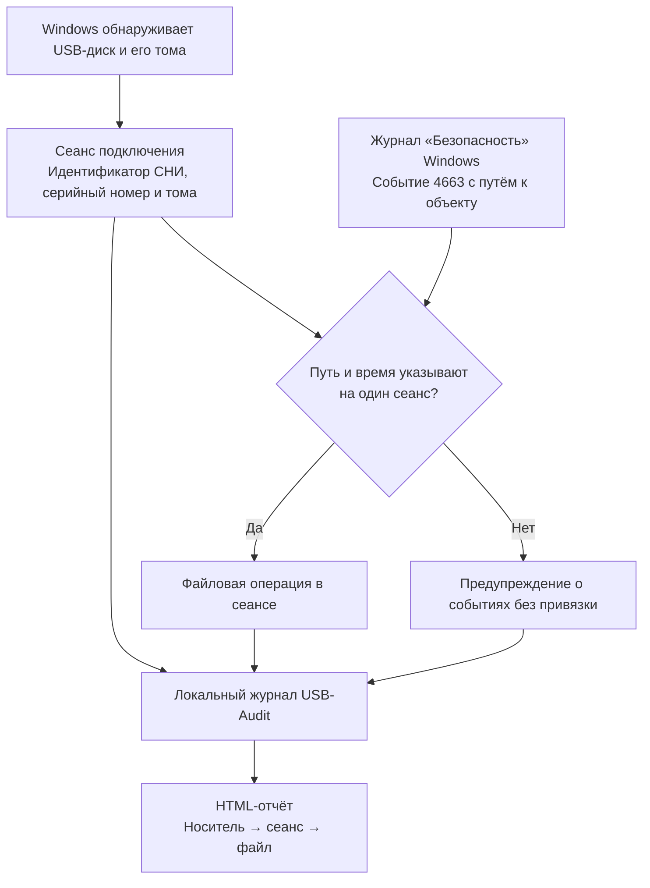

# USB-Audit — журнал USB-носителей в Windows


На автономном рабочем месте нам нужно ответить на три вопроса. Какую флешку подключили? Когда её извлекли? К каким файлам на ней обращались? USB-Audit связывает события Windows с конкретным съёмным носителем информации (СНИ) и сеансом его подключения. Результат открываем в браузере на этом же компьютере.

**[Скачать USB-Audit.exe](https://github.com/Amtonsi/usb-audit/releases/download/v1.0.0/USB-Audit.exe)** · [Скачать руководство с полным листингом](https://github.com/Amtonsi/usb-audit/releases/download/v1.0.0/USB-Audit-Guide.html) · [Контрольные суммы SHA-256](https://github.com/Amtonsi/usb-audit/releases/download/v1.0.0/SHA256SUMS.txt)

## Как читаем историю

Выбираем накопитель по идентификатору экземпляра устройства и аппаратному серийному номеру. Если накопитель не передал номер, в отчёте появится отметка «Не предоставлен устройством». У каждого подключения своя строка. Один и тот же накопитель узнаём и тогда, когда Windows назначила ему другую букву диска.

В выбранном сеансе открываем **«Изменения файлов»**. Например, при записи одного документа Проводник может несколько раз прочитать корень флешки, а для документа запросить запись и добавление данных. В сводке два близких обращения к этому документу отображаются одной строкой «Запись данных» с пометкой «Обращений: 2». Чтобы увидеть чтение, обращение к корню и каждую исходную запись, переключаемся на **«Все обращения»**.


На иллюстрации использованы демонстрационные данные. Скачиваем HTML-пример кнопкой **Download raw file** на GitHub и открываем локально, чтобы выбрать сеанс и попробовать фильтры. [Интерактивный пример отчёта](examples/USB-Audit-demo.html)

## Как устроен сбор



Сборщик запускается заданием Планировщика при загрузке Windows. В состоянии «Извлечён» учитываем источник времени. При наличии уведомления используем время удаления тома в Windows. Если уведомления нет, сборщик проверяет список дисков. Два успешных опроса подряд без накопителя подтверждают отключение. В отчёте видны время последнего присутствия и время первого опроса без диска. Если наблюдение прервалось и подтверждения нет, состояние остаётся «Не определено».

Событие чтения может принадлежать Проводнику, антивирусу или другой программе. По нему устанавливаем путь, учётную запись и процесс. Чтобы определить, куда скопировали прочитанный файл, нужны дополнительные сведения.

## Первый запуск

Для сбора используем **Windows 10 или 11 x64**, встроенную Windows PowerShell 5.1, Планировщик заданий и том NTFS для журнала. Перед установкой сохраняем действующие параметры аудита и разрешения журнала «Безопасность», если АРМ потребуется вернуть к исходным настройкам.

1. Скачиваем EXE и сверяем его контрольную сумму с файлом из этого же выпуска. Помещаем программу в локальную папку, где сотруднику разрешены чтение и запуск, а право записи есть у администраторов.

   ```powershell
   Get-FileHash -LiteralPath .\USB-Audit.exe -Algorithm SHA256
   ```

2. В сеансе сотрудника, которому нужен отчёт, открываем EXE и нажимаем **«Установить»**. Подтверждаем запрос контроля учётных записей Windows (UAC). В списке **«Ответственный за архивы»** выбираем существующего локального администратора и сверяем имя с идентификатором безопасности (SID).
3. После первого добавления сотрудника в группу читателей выходим из сеанса Windows и входим заново. Нажимаем **«Проверить»**, подключаем тестовую флешку и записываем файл с уникальным именем. Закрываем файл и открываем его ещё раз для чтения.
4. Нажимаем **«Открыть журнал»**. Выбираем носитель и нужный сеанс, находим файл по имени. Запись проверяем в сводке, чтение — в режиме «Все обращения». После извлечения снова нажимаем **«Открыть журнал»**, чтобы увидеть обновлённое состояние.

Руководство содержит схемы установки и обработки событий, порядок контрольной проверки, обслуживание архивов и полные исходные тексты. HTML открывается без подключения к сети. [Руководство в репозитории](docs/USB-Audit-Guide.html)

## Кто может читать и удалять журнал

| Роль | Действия |
| --- | --- |
| Сборщик | Добавляет события в активный журнал. |
| Читатель | Открывает историю и сохраняет копию отчёта. В копию попадает полный снимок данных, включая скрытые фильтром строки. |
| Ответственный за архивы | Через программу закрывает текущий журнал или удаляет выбранный закрытый архив. При каждой такой операции подтверждает пароль назначенной учётной записи. |

Доступ к файлам ограничивают разрешения NTFS. Локальный администратор Windows сохраняет системные полномочия менять владельца и права доступа.

## Исходный код и сборка

| Компонент | Назначение |
| --- | --- |
| [Launcher.cs](src/Launcher.cs), [Build.ps1](src/Build.ps1) | Окно приложения, упаковка семи рабочих компонентов в один EXE и сборка. |
| [Install.ps1](src/Install.ps1), [Access.ps1](src/Access.ps1) | Выбор учётной записи, настройка аудита, заданий и разрешений. |
| [Collector.ps1](src/Collector.ps1) | Обнаружение дисков и томов, учёт подключений и привязка файловых событий. |
| [Report.ps1](src/Report.ps1), [viewer.html](src/viewer.html) | Формирование автономного HTML, отображение истории, поиск и сохранение копии. |
| [Maintenance.ps1](src/Maintenance.ps1), [Check.ps1](src/Check.ps1) | Закрытие журнала, удаление выбранного архива и проверка состояния сбора. |

Для локальной сборки открываем 64-разрядную Windows PowerShell 5.1 в корне репозитория. Сценарий использует установленный в Windows компилятор C# из .NET Framework 4.x. Затем запускаем самопроверку собранного EXE. При успехе она перечислит хеши семи встроенных ресурсов и подтвердит проверку сценариев и шаблона HTML.

```powershell
$exe = Join-Path $PWD 'dist\USB-Audit.exe'
& .\src\Build.ps1 -OutputPath $exe
& $exe --self-test | Out-Host
```

## Другие лаборатории

- [Мониторинг рабочих мест в Wazuh](https://github.com/Amtonsi/siem-lab)
- [Сетевые события Cisco ASAv в EVE-NG](https://github.com/Amtonsi/cisco-asav-lab)

## Автор и лицензия

Автор — **Амаль А. ([Amtonsi](https://github.com/Amtonsi))**. Проект распространяется по [лицензии MIT](LICENSE).
