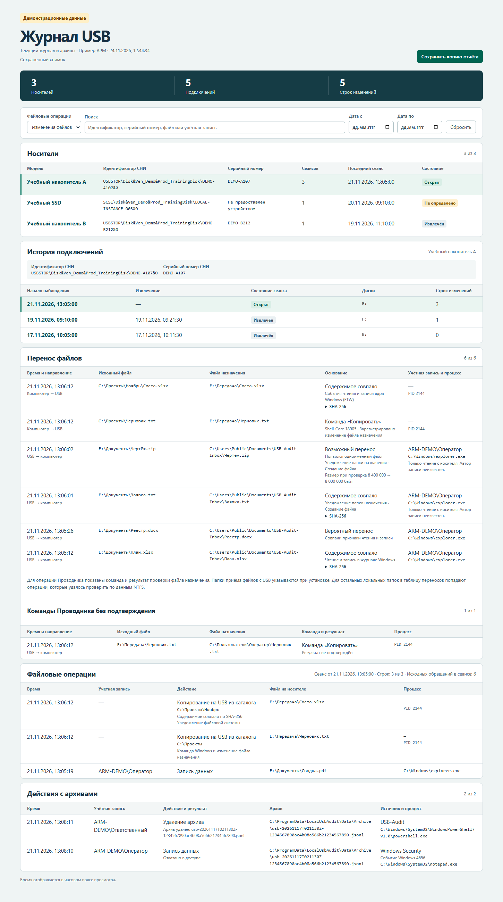
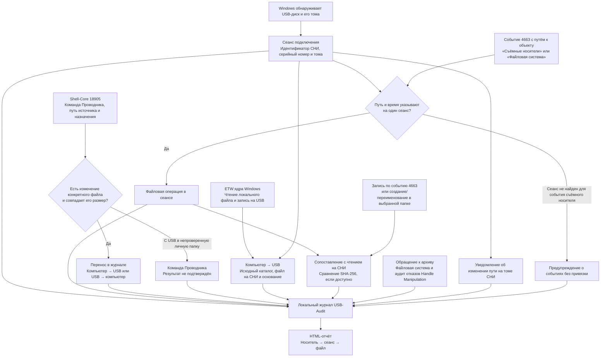

# USB-Audit — журнал USB-носителей в Windows


USB-Audit ведёт на одном компьютере Windows историю подключений съёмных носителей информации (СНИ). В локальном отчёте выбираем флешку по идентификатору и серийному номеру, видим время подключения и извлечения. При копировании или перемещении через Проводник отчёт показывает исходный файл и путь назначения, если Windows зарегистрировала оба пути. Для каждой операции можно проверить, какие события её подтверждают.

**Выпуск 1.2.2 для Windows x64** · [Скачать полный комплект ZIP](https://github.com/Amtonsi/usb-audit/releases/download/v1.2.2/USB-Audit-Windows-x64.zip) · [Программа EXE](https://github.com/Amtonsi/usb-audit/releases/download/v1.2.2/USB-Audit.exe) · [Руководство с полным листингом](https://github.com/Amtonsi/usb-audit/releases/download/v1.2.2/USB-Audit-Guide.html) · [Скрипт удаления](https://github.com/Amtonsi/usb-audit/releases/download/v1.2.2/Uninstall-UsbAudit.ps1) · [Контрольные суммы SHA-256](https://github.com/Amtonsi/usb-audit/releases/download/v1.2.2/SHA256SUMS.txt)

## Как читаем историю

Выбираем накопитель по идентификатору экземпляра устройства и аппаратному серийному номеру. Если накопитель не передал номер, в отчёте появится отметка «Не предоставлен устройством». У каждого подключения своя строка. Один и тот же накопитель узнаём и тогда, когда Windows назначила ему другую букву диска.

В выбранном сеансе открываем **«Файловые операции»**. Например, сотрудник скопировал `D:\Проекты\Сметы\План.xlsx` в `H:\Передача\План.xlsx`. При совпадении SHA-256 в режиме **«Изменения файлов»** видим **«Копирование на USB из каталога»**, исходный каталог `D:\Проекты\Сметы` и файл на флешке. При сопоставлении по чтению и записи видим **«Вероятное копирование на USB из каталога»**. Для просмотра исходных событий выбираем **«Все обращения»**.

Если при удалении Windows записала в журнал безопасности только обращение к корню флешки, имя удалённого файла может прийти из второго источника — уведомления об изменении на томе. Оно показывает, какой путь исчез. При переименовании можно увидеть старое и новое имена. Учётная запись и процесс доступны, когда Windows указала их в событии аудита. Уведомления тома не регистрируют чтение и не позволяют восстановить операции, произошедшие до запуска наблюдения.

Таблица **«Перенос файлов»** показывает время, направление, полный исходный путь, полный конечный путь и основание сопоставления.

Если Проводник сообщил оба пути при копировании с USB, а сборщик не смог проверить файл в личной папке пользователя, откройте **«Команды Проводника без подтверждения»** под таблицей переносов. Там видны время, команда, исходный файл и назначение с пометкой **«Результат не подтверждён»**. Поиск работает по обоим путям. Эти команды учитываются отдельно от переносов и файловых изменений.

Для команд Проводника **«Копировать»** и **«Переместить»** Windows может передать оба пути в одном событии Shell-Core 18905. Сборщик связывает команду с изменением конкретного файла назначения и сверяет размер. Так видны и переносы пустого файла, включая замену существующего. Надпись «Переместить» передаёт название команды Проводника. Для контроля удаления исходника на флешке открываем «Файловые операции» этого сеанса. При установке выбираем папки, в которые принимаем файлы с USB. В остальных локальных папках сборщик может подтвердить копию по сведениям NTFS и проверке файла.

- **Компьютер → USB.** Исходник может находиться в любой папке распознанного локального диска. Сборщик связывает чтение на компьютере с записью того же процесса на флешке по имени файла, времени и сеансу подключения. Сведения о записи могут прийти через ETW или из события Windows Security 4663. Сопоставление работает и при замене файла. Если об изменении существующего файла сообщает только файловая система флешки, нужны зарегистрированное чтение исходника и совпадение содержимого по SHA-256. Когда исходный каталог установить не удалось, запись на USB видна в таблице «Файловые операции».
- **USB → компьютер.** Для этого направления указываем локальные папки назначения при установке. Программа сопоставляет чтение с носителя с записью либо появлением одноимённого файла в выбранной папке. Отметка «Возможный перенос» означает, что папка сообщила о появлении файла, но совпадение содержимого не подтверждено.

«Содержимое совпало» означает одинаковый SHA-256 при проверке. Если доступна только пара чтения и записи, в отчёте будет «Вероятный перенос». Выбор между копированием и перемещением по этой паре установить нельзя.

В таблице **«Действия с архивами»** видим время, учётную запись, архив, действие, результат и источник. Windows регистрирует обращения к файлу или каталогу, в том числе отказ в записи или запрос права удаления. При удалении через USB-Audit отдельно видны этапы подтверждения и результат.



На иллюстрации использованы демонстрационные данные. Скачиваем HTML-пример кнопкой **Download raw file** на GitHub и открываем локально, чтобы выбрать сеанс и попробовать фильтры. [Интерактивный пример отчёта](examples/USB-Audit-demo.html)

## Как устроен сбор



Сборщик запускается заданием Планировщика при загрузке Windows. В состоянии «Извлечён» учитываем источник времени. При наличии уведомления используем время удаления тома в Windows. Если уведомления нет, сборщик проверяет список дисков. Два успешных опроса подряд без накопителя подтверждают отключение. В отчёте видны время последнего присутствия и время первого опроса без диска. Если наблюдение прервалось и подтверждения нет, состояние остаётся «Не определено».

Для доступа к файлу на СНИ сборщик обрабатывает событие Windows 4663 из категорий «Съёмные носители» (`Task=12812`) и «Файловая система» (`Task=12800`). В обоих случаях он сверяет путь и время события с томом конкретного сеанса подключения. Если Windows записала чтение в обеих категориях, в режиме «Все обращения» видны обе исходные записи. При сопоставлении с одной записью назначения в таблице переносов появляется одна строка.

Событие 4663 о чтении может принадлежать Проводнику, антивирусу или другой программе. Оно показывает путь, учётную запись и процесс. Если команды Shell-Core нет, при переносе с USB сборщик ищет в выбранной папке запись того же процесса в одноимённый файл либо уведомление о создании или переименовании. По возможности сравнивает содержимое по SHA-256. Если подходящих источников несколько или зарегистрировано только чтение, в полном режиме остаётся исходное событие доступа. Одной пары чтения и записи недостаточно, чтобы различить команды «Копировать» и «Переместить».

Для выбранных папок проверяем также настройки Windows. Вложенные объекты обычно наследуют правила аудита (SACL) от родительского каталога. Если наследование отключено и собственного правила нет, событие записи может отсутствовать. Вне этих папок сведения об исходном и конечном пути могут поступить от самого Проводника. Тогда основание смотрим в строке переноса либо в разделе команд без подтверждения.

## Первый запуск

Для сбора используем **Windows 10 или 11 x64**, встроенную Windows PowerShell 5.1, Планировщик заданий и том NTFS для журнала. Перед установкой сохраняем действующие параметры аудита и разрешения журнала «Безопасность», если АРМ потребуется вернуть к исходным настройкам.

1. Скачиваем EXE и сверяем его контрольную сумму с файлом из этого же выпуска. Помещаем программу в локальную папку, где сотруднику разрешены чтение и запуск, а право записи есть у администраторов.

   ```powershell
   Get-FileHash -LiteralPath .\USB-Audit.exe -Algorithm SHA256
   ```

2. В сеансе сотрудника, которому нужен отчёт, открываем EXE и нажимаем **«Установить»**. Подтверждаем запрос контроля учётных записей Windows (UAC). В списке **«Ответственный за архивы»** выбираем существующего локального администратора и сверяем имя с идентификатором безопасности (SID). При первой установке предлагается папка «Общие документы\USB-Audit-Inbox». Можно добавить существующие рабочие папки на локальном томе NTFS. Для обновления действующей установки выбираем **«Обновить»**. Выбранные при обновлении папки дополняют сохранённые.
3. После первого добавления сотрудника в группу читателей выходим из сеанса Windows и входим заново. Нажимаем **«Проверить»**, подключаем тестовую флешку и записываем файл с уникальным именем. Закрываем файл и открываем его ещё раз для чтения.
4. Нажимаем **«Открыть журнал»**, выбираем носитель и сеанс, ищем файл по имени. Запись видна в сводке, чтение — в режиме «Все обращения». Копируем один небольшой файл с СНИ в выбранную папку, второй файл только открываем. Оставляем вкладку открытой и ждём, пока сборщик обработает события. Для первого файла проверяем оба пути в строке «USB → компьютер» таблицы «Перенос файлов», для второго — чтение. После извлечения смотрим состояние этого же сеанса.

**Как обновляется вкладка.** Пока читатель находится в Windows, его задание Планировщика обновляет общий отчёт в `%LOCALAPPDATA%\LocalUsbAudit\Reports\USB-Audit.html` по изменениям журнала. Открытая вкладка подхватывает новую версию. После установки обновления один раз обновляем прежнюю вкладку по этому адресу клавишей **F5**. Для пересылки или хранения нажимаем **«Сохранить копию отчёта»**. Копия и отдельно открытый архив содержат события на момент их формирования.

Руководство содержит схемы установки и обработки событий, порядок контрольной проверки, обслуживание архивов и полные исходные тексты. HTML открывается без подключения к сети. [Руководство в репозитории](docs/USB-Audit-Guide.html)

**Если копируем с USB на рабочий стол.** В сеансе сотрудника до подтверждения UAC выполняем в PowerShell `[Environment]::GetFolderPath('DesktopDirectory')`. При установке или обновлении нажимаем **«Добавить папку…»** и выбираем именно этот путь, если рабочий стол расположен на локальном томе NTFS. У администратора, подтверждающего UAC, свой рабочий стол.

**Если видим флешку, но таблица переносов пуста.** Сверяем состояние автообновления и время формирования отчёта. Для направления «Компьютер → USB» копируем через Проводник файл с уникальным именем из локального каталога на флешку и проверяем «Состояние сбора» на сообщения о пропусках ETW. Для направления «USB → компьютер» смотрим «Команды Проводника без подтверждения» и сверяем папку назначения с настройками установки. Тестовый файл оставляем доступным примерно полминуты, чтобы сборщик успел обработать события и проверить доступные сведения о файле.

При переподключении открывается новый сеанс. Если он пуст, кнопка «Открыть подключение с операциями» ведёт к ближайшему предыдущему сеансу этой же флешки, в котором есть записи по текущим фильтрам.

## Кто может читать и удалять журнал

| Роль | Действия |
| --- | --- |
| Сборщик | Добавляет события в активный журнал. |
| Читатель | Открывает историю и сохраняет копию отчёта. В копию попадает полный снимок данных, включая скрытые фильтром строки. |
| Ответственный за архивы | Через программу закрывает текущий журнал или удаляет выбранный закрытый архив. При каждой такой операции подтверждает пароль назначенной учётной записи. |

Для регистрации прямого отказа по имени архива установщик включает аудит успехов и отказов в «Файловой системе» и аудит отказов «Управление дескрипторами» (Handle Manipulation). У последней подкатегории сохраняется действующий флаг успеха. При снятии ПО восстанавливаем исходные режимы по руководству.

В журнале различаем обращение к архиву через Windows и результат обслуживания через USB-Audit. Право удаления используется также при переименовании. Для проверки результата смотрим источник и формулировку события. Полная история доступна кнопкой «Открыть журнал».

Доступ к файлам ограничивают разрешения NTFS. Локальный администратор Windows сохраняет системные полномочия менять владельца и права доступа.

## Исходный код и сборка

| Компонент | Назначение |
| --- | --- |
| [Launcher.cs](src/Launcher.cs), [Build.ps1](src/Build.ps1) | Окно приложения, упаковка двенадцати рабочих компонентов в один EXE и сборка. |
| [Install.ps1](src/Install.ps1), [Access.ps1](src/Access.ps1) | Выбор учётной записи, настройка аудита, заданий и разрешений. |
| [Collector.ps1](src/Collector.ps1) | Обнаружение томов, учёт подключений, обработка аудита Windows и уведомлений об изменениях на СНИ. |
| [DestinationAudit.ps1](src/DestinationAudit.ps1), [TransferAudit.ps1](src/TransferAudit.ps1) | Правила аудита папок назначения, сопоставление событий по пути и сравнение файлов. |
| [KernelFileTrace.cs](src/KernelFileTrace.cs), [KernelTransferMatcher.cs](src/KernelTransferMatcher.cs) | Чтение событий ядра Windows и сопоставление исходного файла на компьютере с записью на СНИ. |
| [ArchiveAudit.ps1](src/ArchiveAudit.ps1) | Правила аудита архивов, регистрация попыток и результатов обслуживания. |
| [Report.ps1](src/Report.ps1), [viewer.html](src/viewer.html) | Обновление общего отчёта в сеансе читателя, просмотр истории, поиск и сохранение копии. |
| [Maintenance.ps1](src/Maintenance.ps1), [Check.ps1](src/Check.ps1) | Закрытие журнала, удаление выбранного архива и проверка состояния сбора. |
| [Uninstall-UsbAudit.ps1](tools/Uninstall-UsbAudit.ps1) | Удаление программы с сохранением журналов, архивов и итогового отчёта активного читателя. |

Для локальной сборки открываем 64-разрядную Windows PowerShell 5.1 в корне репозитория. Сценарий использует установленный в Windows компилятор C# из .NET Framework 4.x. Затем запускаем самопроверку собранного EXE. При успехе она перечислит хеши двенадцати встроенных ресурсов и подтвердит проверку сценариев и шаблона HTML.

```powershell
$exe = Join-Path $PWD 'dist\USB-Audit.exe'
& .\src\Build.ps1 -OutputPath $exe
& $exe --self-test | Out-Host
```

## Снятие программы

После остановки сборщика скрипт записывает итоговый HTML для каждого читателя, у которого работало автообновление. Снимок включает последние записи активного журнала и доступные архивы. Если читатель вышел из Windows или обновление снимка завершилось ошибкой, скрипт выдаёт предупреждение. Сохранённые журналы остаются доступны.

Из корня репозитория запускаем скрипт удаления. Параметр `-WhatIf` позволяет предварительно посмотреть действия. Скрипт запрашивает права администратора, снимает задания программы и её сеанс ETW, удаляет установленные файлы. Архивы, исходный журнал и отчёты остаются доступны читателям. Восстановление системных настроек аудита и полное удаление тестовой истории описаны в руководстве.

```powershell
powershell.exe -NoProfile -ExecutionPolicy Bypass -File ".\tools\Uninstall-UsbAudit.ps1"
```

## Проверка выпуска 1.2.2

Подключаем флешку, открываем общий отчёт и выбираем её сеанс. Копируем на флешку небольшой файл с уникальным именем из локального каталога, который не выбирали при установке. В строке «Компьютер → USB» сверяем каталог и имя исходника, путь назначения и основание. Затем копируем файл с флешки в выбранную локальную папку и проверяем строку «USB → компьютер».

Для проверки замены меняем содержимое своего тестового файла на компьютере и повторяем копирование с заменой на флешке. Оставляем флешку подключённой примерно полминуты. В отчёте открываем сеанс, в котором выполняли замену, и сверяем оба пути. При следующем подключении предыдущие операции доступны в строке прежнего сеанса.

Для проверки пустого файла создаём в своей папке новый текстовый документ размером 0 байт. В Проводнике копируем его на флешку, затем повторяем копирование с заменой. По имени файла находим строки «Компьютер → USB» и проверяем, что в обеих указан исходный каталог. Чтобы проверить перемещение, вырезаем другой тестовый файл и вставляем его в выбранную папку приёма на компьютере. Открываем строку «USB → компьютер» и сверяем команду и пути.

В Windows PowerShell 5.1 из корня репозитория проверяем оба направления, привязку к USB-сеансу, неизвестный исходник, одноимённые файлы в разных папках, несовпадающее содержимое и обработку одних и тех же событий из нескольких источников.

```powershell
& .\tests\check_transfers.ps1
```

## Другие лаборатории

- [Мониторинг рабочих мест в Wazuh](https://github.com/Amtonsi/siem-lab)
- [Сетевые события Cisco ASAv в EVE-NG](https://github.com/Amtonsi/cisco-asav-lab)

## Автор и лицензия

Автор — **Амаль А. ([Amtonsi](https://github.com/Amtonsi))**. Проект распространяется по [лицензии MIT](LICENSE).
